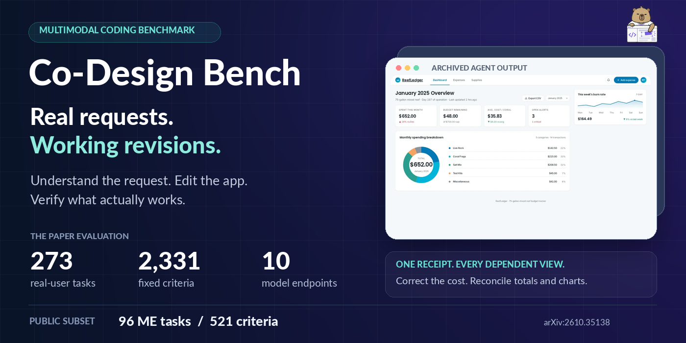
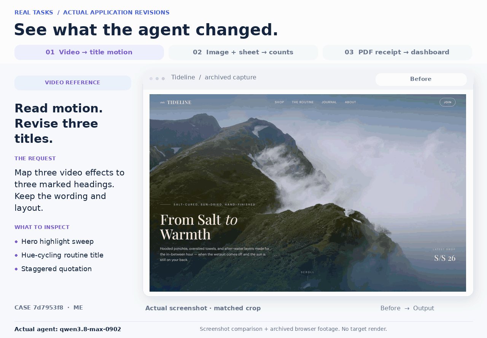
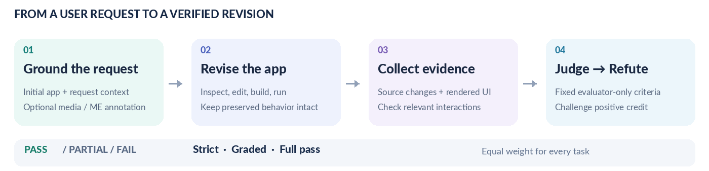

<p align="center">
  
</p>

<h1 align="center">Co-Design Bench</h1>
<p align="center"><strong>Multimodal Collaborative Coding Evaluation for Agentic Models</strong></p>

<p align="center">
  <a href="https://arxiv.org/abs/2610.35138"></a>
  <a href="https://codesignbench.github.io/"></a>
  <a href="docs/dataset.md"></a>
  <a href="#quickstart"></a>
</p>

<p align="center">
  <a href="#see-the-tasks">Task gallery</a> ·
  <a href="#quickstart">Quickstart</a> ·
  <a href="docs/dataset.md">Dataset</a> ·
  <a href="#leaderboard">Leaderboard</a> ·
  <a href="#documentation">Documentation</a> ·
  <a href="#citation">Citation</a>
</p>

Coding agents receive an existing application and a real user's multimodal
request. Co-Design Bench asks whether the final revision satisfies every
requirement, with evidence from its source and running interface.

## See the tasks

<p align="center">
  <a href="docs/case_studies.md"></a>
</p>

**Explore real inputs and revisions:** [case studies](docs/case_studies.md) ·
[interactive task gallery](https://codesignbench.github.io/#cases).

## Why Co-Design Bench?

| Existing applications | Multimodal intent | Judge, then refute |
| --- | --- | --- |
| Revise runnable projects while preserving behavior the user wants to keep. | Ground requests in annotated screenshots and optional audio, video, documents, or images. | Check fixed expert criteria against source and browser evidence, then independently challenge positive credit. |

<p align="center">
  <a href="docs/evaluation.md"></a>
</p>

No gold code or target screenshot is required.
[Evaluation protocol](docs/evaluation.md) ·
[original experiment sources and settings](evaluation/README.md).

## Quickstart

From the repository root, with Python 3.10+:

```bash
python -m pip install -e .
cdb list
cdb score --cases examples/cases.json --results examples/final_verdicts.json
```

This self-contained example uses **two synthetic tasks**, requires no model or
dataset download, and returns **Strict 66.67% · Graded 75.0% · Full pass 50.0%**.
See the [example walkthrough](examples/README.md).

<details>
<summary><strong>Evaluate your agent's application revisions</strong></summary>

Use the solver inputs without rubrics to run your agent. Save each final
application under `submissions/<case_id>/`. Match the evaluation inputs to the
[public manifest](data/public_release_manifest.json), then prepare the cases:

```bash
cdb prepare --dataset /path/to/evaluation-inputs --submissions /path/to/submissions --out work/evaluation
```

Add `--case <public_task_id>` for a smaller run. The reference judge requires an
authenticated Claude CLI, Node.js, Playwright, and Chromium:

```bash
npm install --no-save playwright
npx playwright install chromium
cdb judge --cases work/evaluation/cases.json --out results/run-1 --model opus
cdb score --cases work/evaluation/cases.json --results results/run-1/journal.jsonl --out results/run-1/scores.json
```

Set `--model` to an identifier accepted by your Claude CLI. Run builds and agent
tools in a disposable evaluation environment. The reference runner supports
static frontend applications and npm builds; reproducing the paper also requires
its complete infrastructure and evidence audits.

[Submission format](docs/submissions.md) · [Runtime and evaluation guide](docs/evaluation.md).

</details>

## Dataset

| Scope | Tasks | Acceptance criteria |
| --- | ---: | ---: |
| **Public ME subset** | **96** | **521** |
| Full paper evaluation: 100 ME + 173 RE | 273 | 2,331 |

The public subset covers Multimodal Editing; Repository Editing is outside the
release. Dataset archives are distributed separately from this code repository.
[Dataset format and access](docs/dataset.md) ·
[fixed public case IDs](data/case_ids_me96.txt) ·
[release manifest](data/public_release_manifest.json).

## Leaderboard

**Full 273-task paper evaluation**, using ten model endpoints with the shared
Claude Code harness. All values are percentages; ME and RE strict are per-track
scores.

| Model | Strict | Graded | Full pass | ME strict | RE strict |
| --- | ---: | ---: | ---: | ---: | ---: |
| gpt-6-astra | **69.9** | **75.3** | **26.4** | **75.4** | **66.7** |
| opus-5 | 66.1 | 71.9 | 18.3 | 69.5 | 64.2 |
| qwen3.8-max-0902 | 65.3 | 71.6 | 16.5 | 66.7 | 64.4 |
| qwen3.8-27b | 64.4 | 70.9 | 15.0 | 64.2 | 64.5 |
| kimi-k3 | 62.9 | 69.5 | 15.8 | 66.2 | 61.0 |
| gpt-5.6-sol | 61.1 | 67.9 | 14.3 | 58.3 | 62.7 |
| opus-4-8 | 58.1 | 64.9 | 10.3 | 59.3 | 57.5 |
| glm-5.3-flash | 57.3 | 63.9 | 10.6 | 53.8 | 59.4 |
| glm-5.2 | 56.7 | 63.7 | 9.5 | 57.2 | 56.4 |
| grok-4.6 | 51.1 | 58.0 | 6.6 | 46.7 | 53.6 |

Strict gives credit only to PASS; Graded gives half credit to PARTIAL; Full pass
requires every criterion in a task to PASS. All metrics use **equal weight per
task**. [Metric definitions](docs/evaluation.md#metrics) ·
[interactive leaderboard](https://codesignbench.github.io/#leaderboard).

## Documentation

| Start here | Reference |
| --- | --- |
| [Real case studies](docs/case_studies.md) | Requests, applications, and revisions. |
| [Dataset](docs/dataset.md) · [Submissions](docs/submissions.md) | Task inputs and candidate layout. |
| [Evaluation](docs/evaluation.md) · [Original experiment reference](evaluation/README.md) | Protocol, runtime, and reviewed source configuration. |
| [Scoring example](examples/README.md) | A complete run without model access. |
| [arXiv paper](https://arxiv.org/abs/2610.35138) · [Bundled PDF](docs/Co-Design-Bench.pdf) | Benchmark construction, results, and analysis. |
| [Citation metadata](CITATION.cff) | Import the paper citation into a reference manager. |

## Citation

Please cite [Co-Design Bench (arXiv:2610.35138)](https://arxiv.org/abs/2610.35138)
if you use the benchmark.

<details>
<summary><strong>BibTeX</strong></summary>

```bibtex
@misc{wei2026codesignbench,
  title = {{Co-Design Bench}: Multimodal Collaborative Coding Evaluation for Agentic Models},
  author = {Xilin Wei and Shengyuan Ding and Xinyu Fang and Tiancheng Gu and
            Yuchi Wang and Zhixun Li and Ziyu Liu and Yuhang Zang and
            Weixiang Yu and Cheng Lu and Chonggao Sun and Tong Zhou and
            Dahua Lin and Hang Zhang and Shuai Bai and Dayiheng Liu},
  year = {2026},
  eprint = {2610.35138},
  archivePrefix = {arXiv},
  primaryClass = {cs.AI},
  url = {https://arxiv.org/abs/2610.35138}
}
```

</details>
