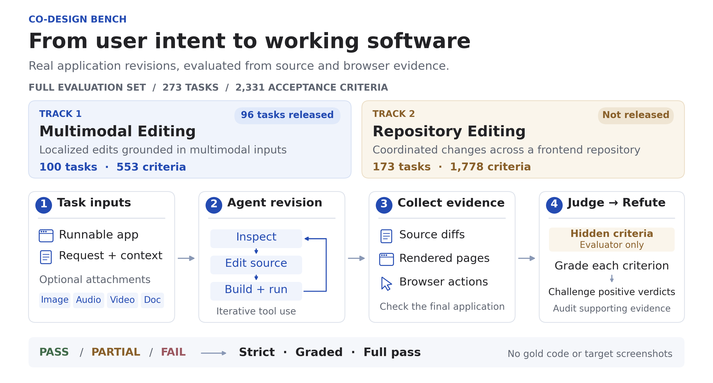
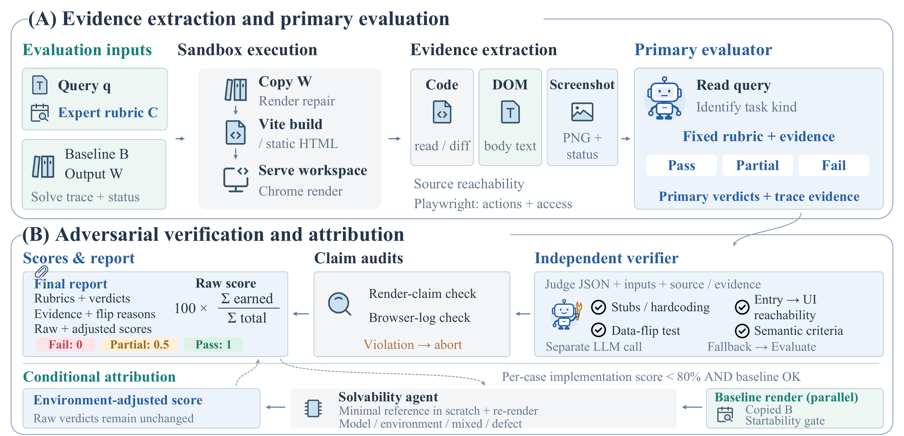

<p align="center">
  
</p>

<h1 align="center">Co-Design Bench</h1>

<p align="center"><strong>Multimodal Collaborative Coding Evaluation for Agentic Models</strong></p>

<p align="center">
  <a href="https://codesignbench.github.io/">Website</a> ·
  <a href="#dataset">Dataset</a> ·
  <a href="#quickstart">Quickstart</a> ·
  <a href="#evaluation">Evaluation</a> ·
  <a href="#documentation">Documentation</a> ·
  <a href="#citation">Citation</a>
</p>

<p align="center">
  📑 <a href="https://arxiv.org/abs/2610.35138">Paper</a>
</p>

[](docs/assets/overview.svg)

*From real-user requests to working application revisions. The overview distinguishes the full 273-task evaluation set from the 96-task subset prepared for public release.*

Co-Design Bench evaluates whether coding agents can turn real users' multimodal
requests into complete, working revisions of existing applications. Agents inspect
a runnable starting application, edit its source, and verify the result in a browser.
Hidden, expert-authored acceptance criteria assess the requested changes and
preservation constraints using source and browser evidence.

Start with the self-contained scoring example below, or use your agent harness to
produce one revised application per task and evaluate it with `cdb prepare`,
`cdb judge`, and `cdb score`.

## Dataset

**The prepared public subset contains 96 Multimodal Editing (ME) tasks and
521 acceptance criteria.** These tasks belong to the full 100-task ME track.
The Repository Editing (RE) track is not released.

This repository contains public data preparation, a reference judge,
task-weighted scoring tools, the paper, documentation, and release metadata.
**The dataset archives are not included.** The [dataset guide](docs/dataset.md)
describes the prepared package, task layout, and release scope.
The public subset has been prepared, but this repository does not yet provide a
public dataset download link. The scoring example is available immediately.

The [public case list](data/case_ids_me96.txt) fixes the 96 task IDs. The
[release manifest](data/public_release_manifest.json) records the scope, counts,
and archive checksums. Primary attachment counts for these 96 tasks are:

| Primary attachment | Tasks |
| --- | ---: |
| Audio | 32 |
| Video | 24 |
| Document | 16 |
| Image | 4 |
| No extra attachment | 20 |
| Total | 96 |

ME tasks identify the edit region on an annotated screenshot. Tasks without an
extra attachment still include the request, initial application, and annotation.

<details>
<summary><strong>Full evaluation set and public release scope</strong></summary>

The paper evaluates **273 tasks and 2,331 acceptance criteria** across two tracks.
The following counts describe the full evaluation set, including unreleased tasks.

| Track | Evaluation tasks | Evaluation criteria | Prepared public subset |
| --- | ---: | ---: | --- |
| Multimodal Editing (ME) | 100 | 553 | 96 tasks / 521 criteria |
| Repository Editing (RE) | 173 | 1,778 | Not released |
| Total | 273 | 2,331 | 96 tasks / 521 criteria |

Across the full 100-task ME track, primary attachment counts are audio 32,
video 27, document 17, image 4, and none 20. RE tasks require coordinated
changes across components, routes, application state, data flow, or content.

</details>

## Quickstart

### 1. Install and try scoring

Open a terminal in this repository's root directory after cloning it or extracting
the release ZIP. Python 3.10+ is required; the Python package has no runtime
dependencies.

```bash
python -m pip install -e .
cdb list
cdb score --cases examples/cases.json --results examples/final_verdicts.json
```

The scoring example uses two **synthetic tasks**, needs no model access or dataset
download, and produces Strict **66.67%**, Graded **75.0%**, and Full pass **50.0%**.

### 2. Prepare candidate applications

Use task inputs without rubrics to run your agent, then place its final source
under `submissions/<case_id>/`. With an extracted evaluation archive:

```bash
cdb prepare --dataset /path/to/evaluation-inputs --submissions /path/to/submissions --out work/evaluation
```

This checks the fixed public task IDs and criteria, then writes `cases.json`.
Add `--case <public_task_id>` to prepare a smaller subset. See the
[submission guide](docs/submissions.md) for input and output layouts.
Match the dataset archives to the public manifest before preparing cases;
archives for the full 273-task experiment use a different task population.

### 3. Judge and score

The reference judge needs an authenticated Claude CLI, Node.js, Playwright,
and Chromium. Run application builds and agent tools in a disposable evaluation
environment. Pass a model name supported by your Claude CLI.

```bash
npm install --no-save playwright
npx playwright install chromium
cdb judge --cases work/evaluation/cases.json --out results/run-1 --model opus
cdb score --cases work/evaluation/cases.json --results results/run-1/journal.jsonl --out results/run-1/scores.json
```

The runner makes two independent agent calls and requires a complete set of final
verdicts before scoring. It supports static frontend applications and npm builds.
It is a **public reference runner**; reproducing the paper also requires its
complete experiment infrastructure and evidence audits. See the
[evaluation guide](docs/evaluation.md) for supported applications and limitations.

## Evaluation

[](docs/assets/evaluation-pipeline.png)

*Judge, then refute: collect evidence for each requirement, assign a verdict, and independently challenge positive credit before aggregating scores.*

Both tracks use the same four stages:

1. **Task inputs.** Provide the runnable pre-edit application, normalized request,
   retained context, and attachments. Keep acceptance criteria hidden from the solver.
2. **Agent revision.** The agent inspects the application, edits source files,
   and builds and runs the result through an agentic harness.
3. **Evidence collection.** Collect source diffs, rendered DOM, screenshots,
   and browser interactions from the final application.
4. **Judge → Refute.** Grade each criterion PASS, PARTIAL, or FAIL. A separate
   verifier challenges PASS and PARTIAL verdicts for stubs, hardcoded outputs,
   unreachable features, and requirement mismatches. Audit evidence before scoring.

Evaluation requires no gold code or target screenshots. For a task with `n`
acceptance criteria, the final verdicts determine its completion scores:

```text
Strict     R = #PASS / n
Graded     G = (#PASS + 0.5 × #PARTIAL) / n
Full pass  F = share of tasks with R = 1
```

Strict and Graded are averaged with **equal weight per task**. PARTIAL earns
no Strict credit and half Graded credit. Full pass counts only tasks where every
criterion is PASS. See the [evaluation guide](docs/evaluation.md) for the protocol.

## Leaderboard

The paper reports ten model endpoints under one shared agentic harness
(Claude Code) on **all 273 tasks: 100 ME + 173 RE**, including unreleased tasks.
Strict, Graded, and Full pass are overall scores; ME strict and RE strict are
per-track scores. **All values below are percentages.**

| Model | Strict | Graded | Full pass | ME strict | RE strict |
| --- | ---: | ---: | ---: | ---: | ---: |
| gpt-6-astra | **69.9** | **75.3** | **26.4** | **75.4** | **66.7** |
| opus-5 | 66.1 | 71.9 | 18.3 | 69.5 | 64.2 |
| qwen3.8-max-0902 | 65.3 | 71.6 | 16.5 | 66.7 | 64.4 |
| qwen3.8-27b | 64.4 | 70.9 | 15.0 | 64.2 | 64.5 |
| kimi-k3 | 62.9 | 69.5 | 15.8 | 66.2 | 61.0 |
| gpt-5.6-sol | 61.1 | 67.9 | 14.3 | 58.3 | 62.7 |
| opus-4-8 | 58.1 | 64.9 | 10.3 | 59.3 | 57.5 |
| glm-5.3-flash | 57.3 | 63.9 | 10.6 | 53.8 | 59.4 |
| glm-5.2 | 56.7 | 63.7 | 9.5 | 57.2 | 56.4 |
| grok-4.6 | 51.1 | 58.0 | 6.6 | 46.7 | 53.6 |

Explore the [interactive leaderboard](https://codesignbench.github.io/#leaderboard)
on the project website.

## Documentation

| Resource | Contents |
| --- | --- |
| [Dataset guide](docs/dataset.md) | Task inputs, prepared package layout, and public release scope. |
| [Submission guide](docs/submissions.md) | Prepare agent outputs and bind them to fixed evaluation criteria. |
| [Evaluation guide](docs/evaluation.md) | Evidence collection, judge-then-refute protocol, and scoring definitions. |
| [Original experiment reference](evaluation/README.md) | Reviewed solve → evaluate settings, source identities, and original visual-claim audit. |
| [Scoring example](examples/README.md) | Run the scorer without model access or benchmark archives. |
| [Paper](docs/Co-Design-Bench.pdf) | Benchmark construction, full evaluation, and analysis. |
| [Public case list](data/case_ids_me96.txt) | The fixed 96 task IDs in their retained order. |
| [Release manifest](data/public_release_manifest.json) | Scope, counts, and prepared archive checksums. |
| [Citation metadata](CITATION.cff) | Authors and arXiv citation for reference managers. |

## Citation

If you use Co-Design Bench, please cite the [arXiv paper](https://arxiv.org/abs/2610.35138):

```bibtex
@misc{wei2026codesignbench,
  title = {{Co-Design Bench}: Multimodal Collaborative Coding Evaluation for Agentic Models},
  author = {Xilin Wei and Shengyuan Ding and Xinyu Fang and Tiancheng Gu and
            Yuchi Wang and Zhixun Li and Ziyu Liu and Yuhang Zang and
            Weixiang Yu and Cheng Lu and Chonggao Sun and Tong Zhou and
            Dahua Lin and Hang Zhang and Shuai Bai and Dayiheng Liu},
  year = {2026},
  eprint = {2610.35138},
  archivePrefix = {arXiv},
  primaryClass = {cs.AI},
  url = {https://arxiv.org/abs/2610.35138}
}
```
